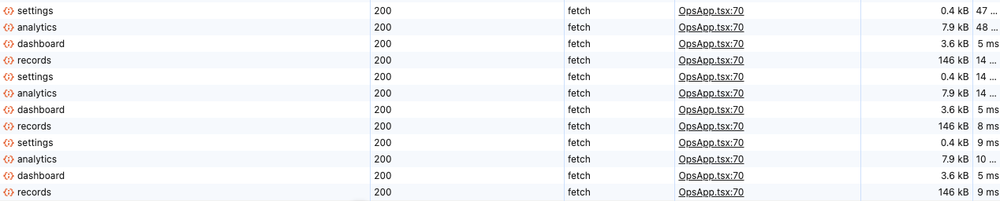
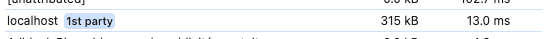
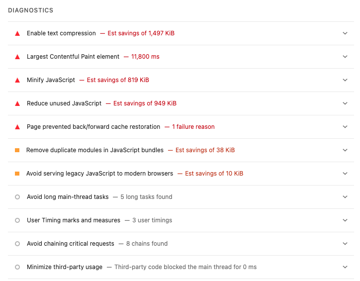

# Devtools

- fetch en boucle sur ces 4 routes :
 GET /api/dashboard
 GET /api/records
 GET /api/settings
 GET /api/analytics

- poids CPU/10sec

# GreenIT plugin
- requêtes : 23
- taille de la page : 2000Ko
- taille du dom : 366
- Ecoindex : 69,61 (D)
- Eau : 2,4 cl
- GES : 1,61 gCO2e

# Lighthouse
- performance : 60
- accessibility : 100
- best practice : 100
- SEO : 82

