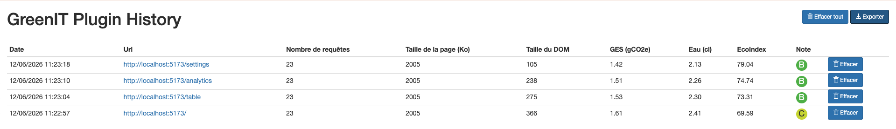
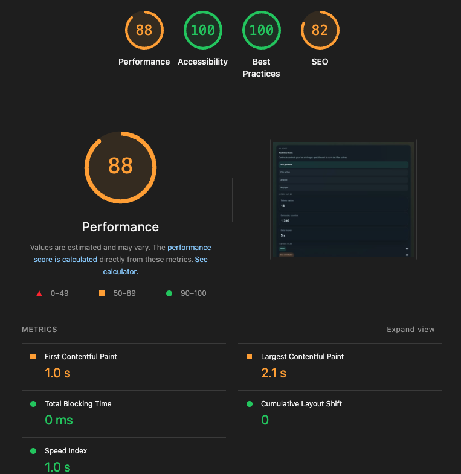

# Audit Initial
>Audit réalisé dans l'optique d'optimiser les performances et réduire la consommation d'un Saas

---

**Outils de mesure utilisés**:

- GreenIt plugin
- Lighthouse

---

## Autres remarques: 

- ``assets/`` contient des fichier .svg lourds non utilisés 
- ``data/records.json`` et ``data/analytics.json``fichier de données volumineux chargé via fetch sur api/records répété toutes les 5 secondes via setInterval.

---

## Quick wins identifiés

| Catégorie | Quick win | Anti-pattern identifié | Effort estimé |
|---|---|---|---|
| Réseau | Supprimer le polling ou augmenter l'intervalle | `setInterval(loadAll, 5000)` sur 4 endpoints | Faible |
| Réseau | Paginer les données côté serveur | `records.json` / `analytics.json` chargés intégralement | Moyen |
| UI | Déplacer les calculs dérivés côté serveur | `teamSummary`, `urgentRecords` recalculés à chaque render | Moyen |
| Media | Supprimer les SVG inutilisés | `assets/ops-panel-*.svg` non référencés | Très faible |

---

## Bonus

Revoir l'architecture générale du repo (dossier type exportés, séparation en composants et en pages, import css intermédiaire inutile...)
